<picture>
  <source media="(prefers-color-scheme: dark)" srcset="assets/banner-dark.svg">
  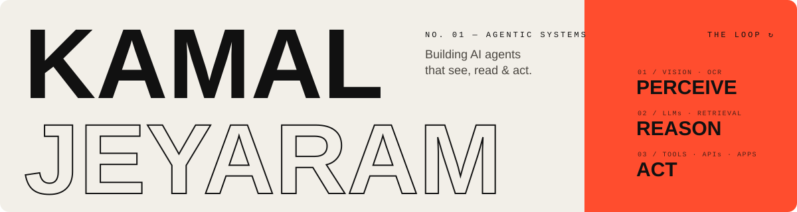
</picture>

 

I build **AI agents** and the parts they're made of. My systems **perceive** the world through vision models and OCR, **reason** with LLMs grounded in retrieval and confidence scores, and **act** through tools, APIs, bots and apps. Then they loop.

What I care about most is the judgment layer: a system that knows when it's confident, when to call a tool, and where every answer came from.

  
  
  

 

<picture>
  <source media="(prefers-color-scheme: dark)" srcset="assets/h-map-dark.svg">
  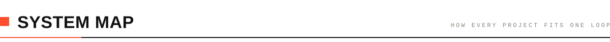
</picture>

<picture>
  <source media="(prefers-color-scheme: dark)" srcset="assets/map-dark.svg">
  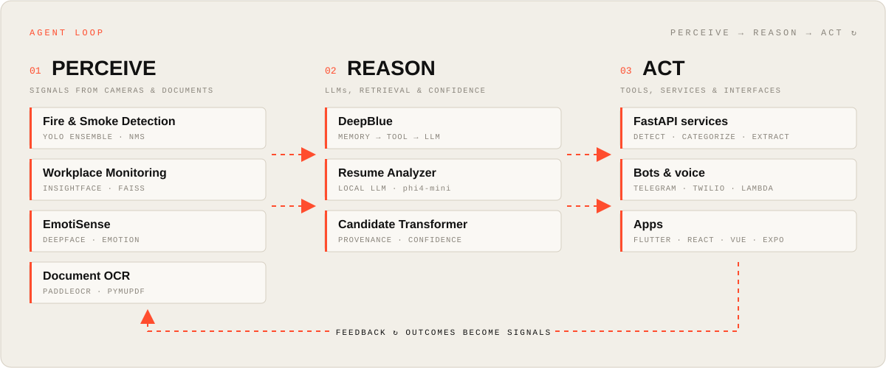
</picture>

### How I build agents

| Principle | Where it shows up in the code |
|---|---|
| **Know when you don't know.** Confidence decides when to escalate. | DeepBlue answers from memory at ≥ 0.6 similarity and calls tools below that. Candidate Transformer scores every field. |
| **Cheapest path first.** Use the light step before the heavy one. | Resume Analyzer reads native text before running OCR. DeepBlue searches FAISS before it calls an LLM. |
| **Ground every answer.** Outputs carry their source. | Candidate Transformer records per-field provenance, and Pydantic validates every profile. |
| **Ship the interface.** A model isn't done until someone can use it. | FastAPI services, a Telegram bot, Twilio voice, and Flutter, React and Vue apps. |

 

<picture>
  <source media="(prefers-color-scheme: dark)" srcset="assets/h-systems-dark.svg">
  
</picture>

<a href="https://github.com/Kamaljeyaram/deepblue"><picture><source media="(prefers-color-scheme: dark)" srcset="assets/card-deepblue-dark.svg">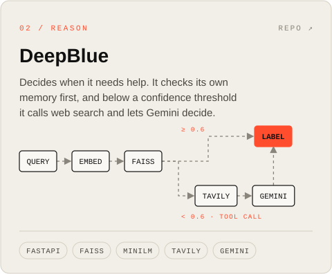</picture></a>
<a href="https://github.com/Kamaljeyaram/ResumeAnalyzer"><picture><source media="(prefers-color-scheme: dark)" srcset="assets/card-resume-dark.svg">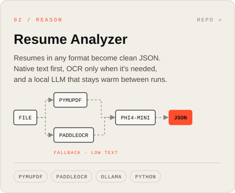</picture></a>
<a href="https://github.com/Kamaljeyaram/eightfold_AI"><picture><source media="(prefers-color-scheme: dark)" srcset="assets/card-candidate-dark.svg">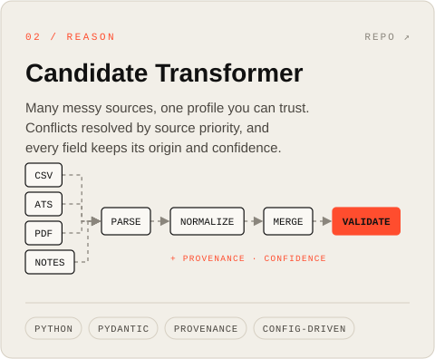</picture></a>
<a href="https://github.com/Kamaljeyaram/smokeandfiredetection"><picture><source media="(prefers-color-scheme: dark)" srcset="assets/card-firesmoke-dark.svg">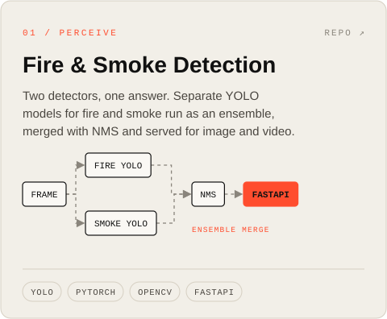</picture></a>
<a href="https://github.com/Kamaljeyaram/Workplace_monitoring"><picture><source media="(prefers-color-scheme: dark)" srcset="assets/card-workplace-dark.svg">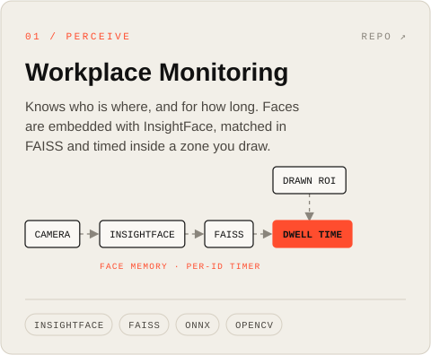</picture></a>
<a href="https://github.com/Kamaljeyaram/emosense_final"><picture><source media="(prefers-color-scheme: dark)" srcset="assets/card-emotisense-dark.svg">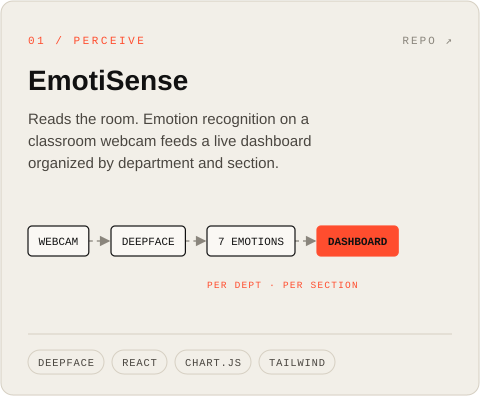</picture></a>

#### Engineering notes

<b>DeepBlue</b>: memory first, tools second

- At startup, labelled examples for each category are embedded with `all-MiniLM-L6-v2` and loaded into a FAISS index.
- Each transaction is matched by nearest-neighbour similarity. A score of **0.6 or higher** is answered from memory, with no LLM call.
- Below the threshold, the system calls **Tavily** web search for context, then sends the transaction and that context to **Gemini 2.0 Flash** to decide.
- Everything sits behind a single `POST /categorize` endpoint on FastAPI.

<b>Resume Analyzer</b>: fast, local document intelligence

- **Text before OCR:** PyMuPDF and python-docx read native text. PaddleOCR runs only when the character count falls below a threshold, which covers scanned PDFs and images.
- **Warm models:** OCR and the LLM load once as singletons and are reused across files.
- **Batch strategy:** text extraction and OCR run in parallel, then LLM calls run one at a time so they don't fight over the GPU.
- **Bounded prompts:** long resumes are truncated before inference (`MAX_LLM_CHARS`).
- **Model:** Ollama `phi4-mini` by default, with an optional Hugging Face transformers backend. Output is structured JSON: name, email, phone, skills and experience.

<b>Candidate Transformer</b>: a data layer agents can trust

- Source-specific parsers handle recruiter CSV, ATS JSON, resume PDFs and free-text notes, and convert each into a shared intermediate format.
- Phone numbers, dates, countries and skills are normalized to canonical forms.
- Duplicates are merged by deterministic identity rules, and conflicts are resolved by **source priority**.
- Every field records its **provenance** and a **confidence** score, and the whole profile is validated with Pydantic.
- Downstream output shapes are defined in a runtime JSON config, so changing them needs no code changes.

<b>Fire & Smoke Detection</b>: an ensemble of detectors

- Two separately trained Ultralytics YOLO weights handle fire and smoke. Their detections are merged with `torchvision.ops.nms`.
- `POST /api/detect` sends a file to the image or video path based on its extension and content type. Video output is encoded with ffmpeg.
- The service runs on FastAPI with a health endpoint and a web frontend.

<b>Workplace Monitoring</b>: identity and time in a zone

- InsightFace (ONNX Runtime) produces face embeddings, and a FAISS index acts as the memory of known faces.
- The region of interest is drawn on the first frame. Faces inside it are boxed green and faces outside it orange.
- A timer for each identity records how long that person stays inside the zone.

<b>EmotiSense</b>: classroom emotion analytics

- DeepFace classifies seven emotions from a webcam feed.
- A React + Vite dashboard with Chart.js groups the results by department and section.
- Built up from two earlier experiments: [facial_emotion](https://github.com/Kamaljeyaram/facial_emotion) (OpenCV + DeepFace) and [emosense_deepface](https://github.com/Kamaljeyaram/emosense_deepface) (desktop GUI).

 

<picture>
  <source media="(prefers-color-scheme: dark)" srcset="assets/h-act-dark.svg">
  
</picture>

| Project | What it does | Stack |
|---|---|---|
| [Serverless Telegram FAQ Bot](https://github.com/Kamaljeyaram/Serverless-Telegram-FAQ-Bot-using-AWS) | Conversational bot answering from a serverless backend | Lambda · API Gateway · DynamoDB |
| [Voice Call Backend](https://github.com/Kamaljeyaram/VoiceCall_Backend) | Programmable voice calling API | Express · Twilio |
| [EduGuide](https://github.com/Kamaljeyaram/eduguide) | Learning app with real-time quizzes and PDF export | Flutter · Firebase · Socket.IO |
| [Deep Doctor](https://github.com/Kamaljeyaram/deep_doctor) | Doctors' portal app with built-in calling | Flutter · Firebase · Agora |
| [Health Stream Dashboard](https://github.com/Kamaljeyaram/Matrix) · [live](https://matrix-alpha-ebon.vercel.app) | Real-time health metrics dashboard | React · TypeScript |
| [Aquaponics](https://github.com/Kamaljeyaram/Aquaponics) · [app](https://github.com/Kamaljeyaram/aquaponics_app) | Monitoring dashboard and companion mobile app | React · Expo |
| [Book Backend](https://github.com/Kamaljeyaram/book-backend) | REST API with search, paging and PDF upload | Node · Express |
| [Freelance](https://github.com/Kamaljeyaram/freelance) · [live](https://freelance-beta-ten.vercel.app) | Freelance services site | Vue 3 · Vite |

 

<picture>
  <source media="(prefers-color-scheme: dark)" srcset="assets/h-signals-dark.svg">
  
</picture>

<picture>
  <source media="(prefers-color-scheme: dark)" srcset="https://raw.githubusercontent.com/Kamaljeyaram/kamaljeyaram/output/signals-dark.svg">
  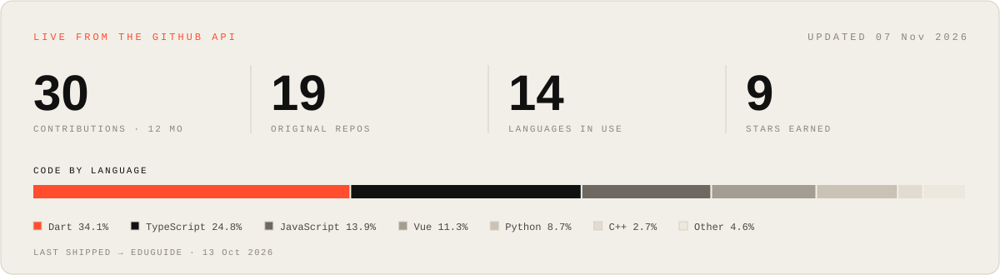
</picture>

<picture>
  <source media="(prefers-color-scheme: dark)" srcset="https://raw.githubusercontent.com/Kamaljeyaram/kamaljeyaram/output/github-snake-dark.svg">
  
</picture>

**Recently shipped** · refreshed daily

<!-- RECENT:START -->
| Repository | Language | Last push |
|---|---|---|
| [eduguide](https://github.com/Kamaljeyaram/eduguide) | Dart | Oct 2026 |
| [ResumeAnalyzer](https://github.com/Kamaljeyaram/ResumeAnalyzer) | Python | Jul 2026 |
| [smokeandfiredetection](https://github.com/Kamaljeyaram/smokeandfiredetection) | Python | Jul 2026 |
| [deep_doctor](https://github.com/Kamaljeyaram/deep_doctor) | Dart | Feb 2026 |
| [VoiceCall_Backend](https://github.com/Kamaljeyaram/VoiceCall_Backend) | JavaScript | Feb 2026 |
<!-- RECENT:END -->

 

<picture>
  <source media="(prefers-color-scheme: dark)" srcset="assets/h-toolbox-dark.svg">
  
</picture>

<picture>
  <source media="(prefers-color-scheme: dark)" srcset="assets/toolbox-dark.svg">
  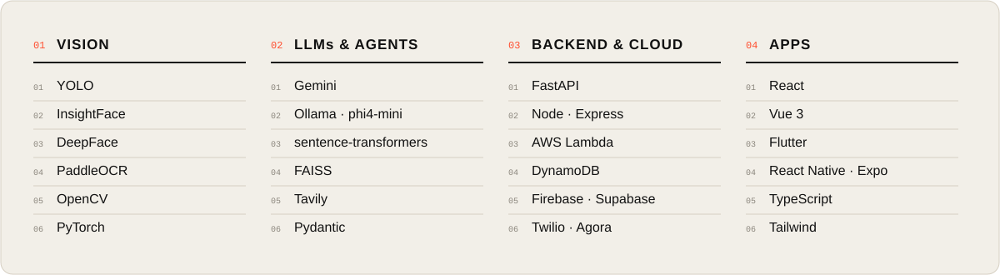
</picture>

  

<picture>
  <source media="(prefers-color-scheme: dark)" srcset="assets/footer-dark.svg">
  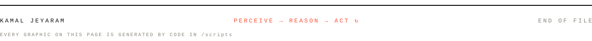
</picture>
